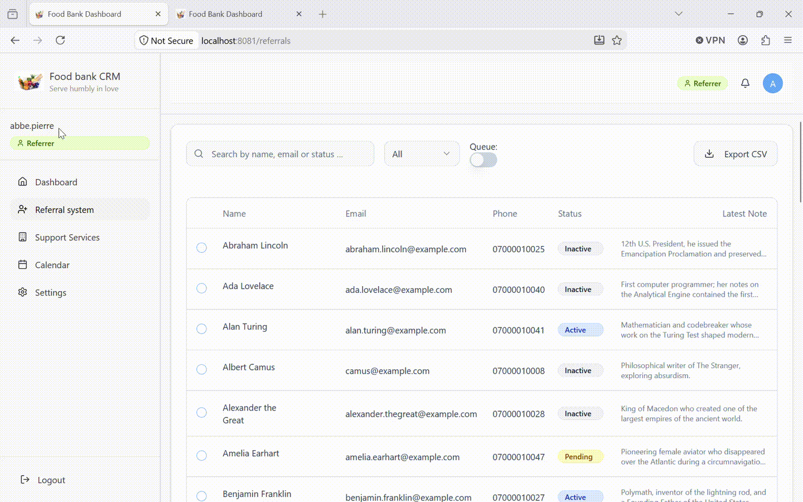

# Food bank CRM 

Full stack infrastructure to support food banks, referrers, volunteers and beneficiaries

This project is built with:
- PostgreSQL
- Vite
- TypeScript
- React
- Radix-ui/Shadcn-ui
- Tailwind CSS

Look and feel:

- [User sign-up and approval process](assets/Admin-approve-user.gif)
- [Organisation management](assets/Admin-org-manage.gif)
- [Opening hours settings](assets/Other-settings2.gif)
- [Current contact referral](assets/Contact-current-refer.gif)
- [How the process works when beneficiaries collect food](assets/Contact-allotment.gif)
- [Merging contacts](assets/Contact-merge.gif)
- [Rating a referrer](assets/Referrer-rating.gif)
- [Dashboard](assets/Dashboard.gif)
- [Other tabs - support services, calendar and tasks](assets/Other-tabs.gif)
- [Logs](assets/Admin-logs.gif)
- [Settings for users - profile, preferences and security](assets/Other-settings.gif)

Repo limitation:
- Edge functions currently use depreciated SUPABASE_SERVICE_ROLE_KEY. Use SUPABASE_SECRET_KEYS issued through JWT Signing Keys instead.
- Several security definer functions need to be revised to invoker
- Facility for password reset is currently a placeholder
- Email client not chosen or tested - for auth, password reset and email notifications
- Full suite of tests have not yet been prepared (vitest etc.)
- Runtime tests carried out locally with two users. Longer term testing needed

AI usage:
- Local AI inference using open weight models (Qwen 3.6 35B A3B, GPT-OSS 20B and Gemma 4 E4B)
- Drafting code and debugging for clearly defined tasks within the competence of the calling developer (no 'agentic' AI)